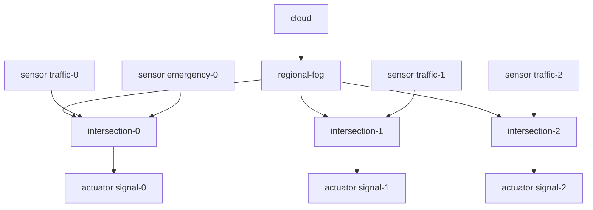
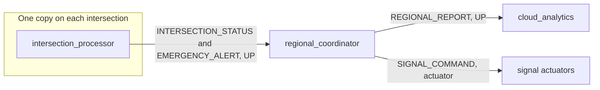

# First-review traffic application design

Date: 6 November 2026.  
Simulator commit: `5f68d3947e450d8d2b4af42670be819206be68c9`.  
Status: implemented as `org.traffic.prototype.TrafficManagementPrototype` and executed once on 6 November 2026. The run exited 0 and printed both loop lines. Device sizes, edge lengths, and sensor intervals remain assumptions about traffic, not measured road values. The execution transcript is in `docs/FIRST_TRAFFIC_SIMULATION.md`.

This document is a blueprint for a small runnable scenario. It is not EAAS, not a traffic-signal controller, and not a claim about real roads. CPU lengths, bandwidths, latencies, and sensor intervals below are **assumptions** chosen so the first run is short and readable. They are not measured traffic values.

Labels:

- **Verified:** read from the cited method in this checkout. Where a later section says the 6 November 2026 run observed a line, that observation is one execution of this class, not a repeated experiment.
- **Assumption:** a number or naming choice for the prototype.
- **Rejected for this prototype:** a proposed hop that the current routing code will not perform.

## 1. System overview

One application, `traffic_management`, runs on a three-level tree:

```text
cloud
  └── regional-fog
        ├── intersection-0
        ├── intersection-1
        └── intersection-2
```

Each intersection has a traffic sensor and a signal actuator. Intersection 0 also has an emergency sensor. Three module names exist:

| Module | Instances | Device |
| --- | --- | --- |
| `intersection_processor` | 3, one per intersection | `intersection-0`, `intersection-1`, `intersection-2` |
| `regional_coordinator` | 1 | `regional-fog` |
| `cloud_analytics` | 1 | `cloud` |

Two workflows:

1. **Congestion monitoring.** A traffic sensor emits `TRAFFIC_SAMPLE`. The local `intersection_processor` emits `INTERSECTION_STATUS` upward. `regional_coordinator` emits `REGIONAL_REPORT` upward. `cloud_analytics` consumes it and emits nothing.
2. **Emergency response.** The emergency sensor emits `EMERGENCY_EVENT`. The local processor emits `EMERGENCY_ALERT` upward. `regional_coordinator` emits `SIGNAL_COMMAND` as an actuator tuple. That tuple is delivered to every signal actuator under the regional device.

The second workflow does **not** send `SIGNAL_COMMAND` back through `intersection_processor`. Section 9 explains why a downward module edge cannot broadcast to all three processor copies.

Placement for this prototype is static and explicit: `ModuleMapping` plus `ModulePlacementMapping`, the same pair `TwoApps` uses. No scheduler policy is added.

## 2. Physical topology



**Verified construction path.** `VRGameFog.createFogDevice` is the pattern to copy, not to edit. It builds one `PowerHost`, one `Pe` with `PeProvisionerOverbooking`, `RamProvisionerSimple`, `BwProvisionerOverbooking`, `StreamOperatorScheduler`, and `FogLinearPowerModel`, then calls the public constructor:

`FogDevice(String name, FogDeviceCharacteristics, VmAllocationPolicy, List<Storage>, double schedulingInterval, double uplinkBandwidth, double downlinkBandwidth, double uplinkLatency, double ratePerMips)`

(`simulator/src/org/fog/entities/FogDevice.java`, lines 91–97).

After construction, `setParentId` links the tree and `setUplinkLatency` stores the delay toward the parent. `Controller.connectWithLatencies` copies each child's uplink latency into the parent's `childToLatencyMap` and appends the child id (`simulator/src/org/fog/placement/Controller.java`, lines 59–67). Routing uses those parent and child lists. `setLevel` is stored and is not consulted by `processTupleArrival`.

The cloud device **must** be named `cloud`. `Controller.getCloud` searches for that exact name, and `printCostDetails` calls `getTotalCost` on the result (`Controller.java`, lines 118–126). Another name makes the stock controller throw at stop.

**Assumption, device sizes.** These are starting values, in the same units `VRGameFog` passes (MIPS, MB of RAM, bandwidth units, latency in simulation time, watts):

| Device | MIPS | RAM | Uplink bandwidth | Downlink bandwidth | Uplink latency | Busy / idle power | Parent |
| --- | ---: | ---: | ---: | ---: | ---: | --- | --- |
| `cloud` | 44800 | 40000 | 100 | 10000 | 0 | 1648 / 1332 | none (`parentId = -1`) |
| `regional-fog` | 8000 | 8000 | 10000 | 10000 | 100 | 200 / 100 | `cloud` |
| `intersection-0` | 3000 | 4000 | 10000 | 10000 | 4 | 150 / 90 | `regional-fog` |
| `intersection-1` | 3000 | 4000 | 10000 | 10000 | 4 | 150 / 90 | `regional-fog` |
| `intersection-2` | 2000 | 4000 | 10000 | 10000 | 6 | 150 / 90 | `regional-fog` |

Intersection 2 is deliberately slower and one hop farther in latency so a later comparison can show heterogeneity. That difference is an assumption, not a measurement. Host storage of `1000000` and host bandwidth `10000` match the `VRGameFog` host setup. Scheduling interval `10` matches the `10` passed to `new FogDevice` in `VRGameFog.createFogDevice`. `ratePerMips` is `0.01` on the cloud and `0` elsewhere, matching the example's cloud-versus-edge split.

`Controller` must be constructed with the device list in parent-before-child order is not required. Child order follows the list order passed to the constructor, because `connectWithLatencies` iterates that list. Keep the list order `cloud`, `regional-fog`, `intersection-0`, `intersection-1`, `intersection-2` so downlink broadcast order is stable.

## 3. Application modules



**Verified.** `Application.addAppModule(String moduleName, int ram)` creates one `AppModule` template with MIPS 1000, bandwidth 1000, size 10000, and a `TupleScheduler` (`simulator/src/org/fog/application/Application.java`, lines 63–72). The `ram` argument is the only size the caller passes. Use `10`, the same value `VRGameFog` uses, so the module fits in every host RAM above.

Adding the name to the application once does **not** place a copy on a device. Placement is a separate step.

**Verified, multiple devices.** `ModuleMapping.addModuleToDevice(String moduleName, String deviceName)` stores the module name under that device if it is not already listed (`simulator/src/org/fog/placement/ModuleMapping.java`, lines 36–41). The comment above the method mentions `instanceCount`, but the method does not take a count. Calling it twice for the same device and the same module does not create two instances.

`ModulePlacementMapping.mapModules` walks that map and calls `createModuleInstanceOnDevice` once per listed name (`simulator/src/org/fog/placement/ModulePlacementMapping.java`, lines 16–27). `ModulePlacement.createModuleInstanceOnDevice` (`simulator/src/org/fog/placement/ModulePlacement.java`, lines 47–69):

- uses the template object for the first device that receives that module name;
- constructs `new AppModule(template)` for every later device;
- calls `canBeCreated`, which calls `host.vmCreate`.

The copy constructor assigns a new entity id and a new `TupleScheduler`, and shares the template's selectivity map (`simulator/src/org/fog/application/AppModule.java`, lines 78–89). It does not copy `actuatorSubscriptions`. That does not affect this design, because actuator delivery does not read that map (section 5).

So three `addModuleToDevice("intersection_processor", "intersection-k")` calls create three VM objects if each `vmCreate` succeeds. One call on `regional-fog` and one on `cloud` create the other two modules. Device names must match exactly. `getDeviceByName` uses `String.equals` (`ModulePlacement.java`, lines 72–77). A missing name makes `mapModules` throw when it dereferences the null device. That failure mode is unverified by a run, but the null return is verified.

`ModulePlacementMapping` is the right policy for a fixed review topology. `ModulePlacementEdgewards` would re-decide locations from CPU-load estimates and can walk a module to the cloud, which is what `VRGameFog` did for `concentration_calculator`. Do not use it for this prototype.

## 4. Sensors and actuators

**Verified attachment.**

`new Sensor(name, tupleType, userId, appId, distribution)` does not set the gateway or the latency (`simulator/src/org/fog/entities/Sensor.java`, lines 62–68). The prototype must call `setGatewayDeviceId` and `setLatency` before `CloudSim.startSimulation`. `setSensorName(tupleType)` inside that constructor makes the sensor's loop name equal to its tuple type.

`Sensor.transmit` finds the `AppEdge` whose **source** equals `getTupleType()`, then sends `FogEvents.TUPLE_ARRIVAL` to `gatewayDeviceId` after `getLatency()` (lines 71–94). The tuple direction is hardcoded to `Tuple.UP`. The edge's direction field is not copied. If `intersection_processor` is on that gateway, `processTupleArrival` executes it locally and the UP direction is unused. If the module is missing, the tuple only climbs to parents.

`new Actuator(name, userId, appId, actuatorType)` likewise leaves gateway id at 0 (`simulator/src/org/fog/entities/Actuator.java`, lines 33–37). Call `setGatewayDeviceId` and `setLatency`. `startEntity` sends `ACTUATOR_JOINED` with the latency value. `FogDevice.processActuatorJoined` stores `(actuatorId, latency)` (`FogDevice.java`, lines 394–397).

`Controller.submitApplication` sets each sensor's and actuator's `Application` (`Controller.java`, lines 194–199). Sensors must share the application's `appId`, or `getApplications().get(sensor.getAppId())` returns null and `transmit` fails.

| Endpoint | Tuple type or actuator type | Gateway | Latency assumption |
| --- | --- | --- | --- |
| `traffic-0` | `TRAFFIC_SAMPLE` | `intersection-0` | 1 |
| `traffic-1` | `TRAFFIC_SAMPLE` | `intersection-1` | 1 |
| `traffic-2` | `TRAFFIC_SAMPLE` | `intersection-2` | 1 |
| `emergency-0` | `EMERGENCY_EVENT` | `intersection-0` | 1 |
| `signal-0` | actuator type `SIGNAL` | `intersection-0` | 1 |
| `signal-1` | actuator type `SIGNAL` | `intersection-1` | 1 |
| `signal-2` | actuator type `SIGNAL` | `intersection-2` | 1 |

Actuator **type** must equal the actuator edge's **destination**, not the tuple type. `sendTupleToActuator` compares `tuple.getDestModuleName()` with `actuator.getActuatorType()` (`FogDevice.java`, lines 658–664). In `VRGameFog` both strings are `DISPLAY`, while the tuple type is `SELF_STATE_UPDATE`. Here the destination string is `SIGNAL` and the tuple type is `SIGNAL_COMMAND`.

## 5. Application graph

`Application.createApplication("traffic_management", broker.getId())`, then `addAppModule`, `addAppEdge`, and `addTupleMapping`. `addAppEdge` of the non-periodic form is `addAppEdge(source, destination, tupleCpuLength, tupleNwLength, tupleType, direction, edgeType)` (`Application.java`, lines 102–107). `getEdgeMap` keeps one edge per tuple-type string. All six tuple types below are distinct, so they do not overwrite each other.

| Edge source | Edge destination | Tuple type | Declared direction | Edge kind | CPU length | Network length |
| --- | --- | --- | --- | --- | ---: | ---: |
| `TRAFFIC_SAMPLE` | `intersection_processor` | `TRAFFIC_SAMPLE` | `Tuple.UP` | `AppEdge.SENSOR` | 3000 | 500 |
| `EMERGENCY_EVENT` | `intersection_processor` | `EMERGENCY_EVENT` | `Tuple.UP` | `AppEdge.SENSOR` | 2000 | 200 |
| `intersection_processor` | `regional_coordinator` | `INTERSECTION_STATUS` | `Tuple.UP` | `AppEdge.MODULE` | 2000 | 800 |
| `intersection_processor` | `regional_coordinator` | `EMERGENCY_ALERT` | `Tuple.UP` | `AppEdge.MODULE` | 1500 | 400 |
| `regional_coordinator` | `cloud_analytics` | `REGIONAL_REPORT` | `Tuple.UP` | `AppEdge.MODULE` | 3000 | 1200 |
| `regional_coordinator` | `SIGNAL` | `SIGNAL_COMMAND` | `Tuple.DOWN` | `AppEdge.ACTUATOR` | 100 | 300 |

CPU and network lengths are **assumptions**, in the units those edge fields already use (CPU length becomes the cloudlet length; network length becomes `cloudletFileSize`). At 3000 MIPS with no sharing, a length of 3000 finishes in about one simulation time unit, because `CloudletScheduler.updateCloudletsProcessing` adds `timeSpan * allocatedMips * Consts.MILLION` of finished work. That scale comment is an interpretation of the scheduler, not a timed traffic experiment.

Selectivity, all `new FractionalSelectivity(1.0)`:

| Module | Input tuple type | Output tuple type |
| --- | --- | --- |
| `intersection_processor` | `TRAFFIC_SAMPLE` | `INTERSECTION_STATUS` |
| `intersection_processor` | `EMERGENCY_EVENT` | `EMERGENCY_ALERT` |
| `regional_coordinator` | `INTERSECTION_STATUS` | `REGIONAL_REPORT` |
| `regional_coordinator` | `EMERGENCY_ALERT` | `SIGNAL_COMMAND` |

**Verified.** `getResultantTuples` emits an output only when the module's selectivity map contains the pair `(input type, output edge type)` and `canSelect()` is true (`Application.java`, lines 195–255). A traffic sample therefore does not emit `EMERGENCY_ALERT`, and a status update does not emit `SIGNAL_COMMAND`. `FractionalSelectivity.canSelect` returns `Math.random() < selectivity` (`FractionalSelectivity.java`, lines 26–29). `Math.random()` is in `[0.0, 1.0)`, so a selectivity of `1.0` is always true. Use `1.0` for this prototype. Do not use `0.9`. `BurstySelectivity` exists and is deterministic in time, but it is not needed for the first run.

For an actuator edge, `getResultantTuples` forces the new tuple's direction to `Tuple.ACTUATOR` and sets `destModuleName` to the edge destination (`Application.java`, lines 207–224). The `Tuple.DOWN` stored on the edge is not the direction of the tuple that is sent. `processTupleArrival` sees `Tuple.ACTUATOR` and calls `sendTupleToActuator` before any module lookup (`FogDevice.java`, lines 696–698).

### Why the signal is an actuator broadcast

**Verified.** `sendTupleToActuator` delivers the tuple to a local actuator whose type equals `destModuleName`. If this device has none, it calls `sendDown` for every child (`FogDevice.java`, lines 658–669). `regional-fog` has no `SIGNAL` actuator. Each intersection does. The first `sendDown` occupies the single south link; the other two tuples wait in `southTupleQueue` and leave in FIFO order (`sendDown`, lines 902–909). All three actuators receive a copy. They do not receive it at the same simulation time.

**Rejected for this prototype.** A module edge `regional_coordinator -> intersection_processor` with `Tuple.DOWN` and tuple type `SIGNAL_COMMAND` does not broadcast execution to all three processors. `checkCloudletCompletion` copies `moduleCopyMap` and records the module that just ran (`FogDevice.java`, lines 516–520). The emergency tuple already recorded `intersection_processor` as the VM on `intersection-0`. When the downward tuple arrives, a device that hosts `intersection_processor` drops it if the map's VM id is not the local VM (`FogDevice.java`, lines 727–731). Only `intersection-0` would execute it. `intersection-1` and `intersection-2` would discard it. The commented `getChildIdForTuple` path is not active.

The actuator path never reaches that check. That is why `SIGNAL_COMMAND` targets actuator type `SIGNAL` rather than the processor module.

### Loops to register

`new AppLoop` with these name lists, in this order:

1. `TRAFFIC_SAMPLE`, `intersection_processor`, `regional_coordinator`, `cloud_analytics`
2. `EMERGENCY_EVENT`, `intersection_processor`, `regional_coordinator`, `SIGNAL`

**Verified measurement limits.**

- `Sensor.updateTimings` returns on the first loop that contains the sensor edge (`Sensor.java`, lines 97–110). These two loops start with different edges, so each emission can be tracked.
- The congestion loop ends when `cloud_analytics` **receives** `REGIONAL_REPORT`. `updateTimingsOnReceipt` runs before `executeTuple` (`FogDevice.java`, lines 735–737 and 758–764). Cloud CPU time is outside that average.
- The emergency loop ends in `Actuator.processTupleArrival` when destination `SIGNAL` is the loop's end module (`Actuator.java`, lines 63–80). The first actuator to run removes `emitTimes` for that id. The other two actuators still get the tuple, but they do not update the average. The printed loop delay is the first delivery, not a per-intersection sample, and not a p95.

`Controller` still prints one running mean per loop and then calls `System.exit(0)`. Per-intersection latency is not available from that printout.

## 6. Workload

**Verified.** `DeterministicDistribution.getNextValue` returns the constant passed to the constructor (`simulator/src/org/fog/utils/distribution/DeterministicDistribution.java`, lines 12–14). `Sensor.startEntity` schedules the first `EMIT_TUPLE` at `getNextValue() + transmissionStartDelay` (`Sensor.java`, lines 114–117). The delay field defaults to `Config.TRANSMISSION_START_DELAY`, which is 50 (`Config.java`, line 25). `setTransmissionStartDelay` can change it per sensor. After each emit, the sensor schedules another emit after `getNextValue()` only (`Sensor.java`, lines 125–127). A sensor does not stop by itself.

There is no public "emit N times" API. A finite burst in this prototype means choosing an interval that fits a known count into `Config.MAX_SIMULATION_TIME`.

**Assumption.**

| Sensor | Distribution | First emit | Later period | Count inside a run of length 1000, approximately |
| --- | --- | ---: | ---: | --- |
| each `traffic-*` | `DeterministicDistribution(20)` | 70 | 20 | about 46, from time 70 through the last emit before 1000 |
| `emergency-0` | `DeterministicDistribution(200)` | 250 | 200 | emits at 250, 450, 650, 850 |

Set `Config.MAX_SIMULATION_TIME = 1000` from the research `main` before starting the simulation. The field is a public static int (`Config.java`, line 6). That assignment is research code, not an edit to `simulator/src`. The stock default of 2000 would also run; 1000 keeps the review shorter.

These intervals are not vehicle headways. They exist so a reviewer can see regular status traffic and four emergency alerts in one log.

`FractionalSelectivity(1.0)` does not drop outputs. The remaining non-determinism in the stock controller is whatever `HashMap` iteration `ModulePlacementMapping` uses while walking device names. The set of placed devices is fixed by the keys. Which device receives the original module object versus a clone can change across JVMs. Both objects share the selectivity map and both are real VMs, so the tuple routes should be the same. That identity swap is not a reason to expect different loop membership. It is still a reason not to treat object ids as stable across launches.

## 7. Initial simulation parameters

Collected here so the implementation has one place to copy. Every numeric row is an **assumption**.

| Parameter | Value | Where it is set |
| --- | --- | --- |
| `Config.MAX_SIMULATION_TIME` | 1000 | research `main`, before `startSimulation` |
| Sensor start delay | 50, the existing default | leave `Config.TRANSMISSION_START_DELAY` unchanged |
| Traffic period | 20 | `DeterministicDistribution` |
| Emergency period | 200 | `DeterministicDistribution` |
| Sensor and actuator latency | 1 | `setLatency` |
| Module RAM | 10 | `addAppModule` |
| Scheduling interval | 10 | `FogDevice` constructor |
| Selectivity | 1.0 | `FractionalSelectivity` |
| App id | `traffic_management` | `Application.createApplication` |

Device MIPS, bandwidth, latency, and power are in section 2. Edge lengths are in section 5.

## 8. Module-to-device mapping

```java
ModuleMapping mapping = ModuleMapping.createModuleMapping();
mapping.addModuleToDevice("intersection_processor", "intersection-0");
mapping.addModuleToDevice("intersection_processor", "intersection-1");
mapping.addModuleToDevice("intersection_processor", "intersection-2");
mapping.addModuleToDevice("regional_coordinator", "regional-fog");
mapping.addModuleToDevice("cloud_analytics", "cloud");

ModulePlacement placement = new ModulePlacementMapping(fogDevices, application, mapping);
controller.submitApplication(application, 0, placement);
```

**Verified API shape.** `ModuleMapping.createModuleMapping` and the two-argument `addModuleToDevice` are public (`ModuleMapping.java`, lines 15 and 36). `ModulePlacementMapping`'s constructor calls `mapModules` immediately (`ModulePlacementMapping.java`, lines 31–41), which matches `TwoApps` building the mapping before `CloudSim.startSimulation`. `Controller.submitApplication(Application, int, ModulePlacement)` stores the policy and wires sensors (`Controller.java`, lines 188–209). Launch events are sent later from `Controller.startEntity` via `processAppSubmit` (lines 222–238): `ACTIVE_APP_UPDATE`, then `APP_SUBMIT` and `LAUNCH_MODULE` for each placed module object.

`LAUNCH_MODULE` calls `processVmCreate` again (`FogDevice.java`, line 824) after placement already called `vmCreate`. The 6 November 2026 run reached the results block with all five `Creating` lines, so the second create did not stop this topology. `Log.disable()` hides the allocation messages from that call, so the log does not show whether the second create printed a failure before the tuples ran. Section 12 records what the run actually printed.

## 9. Simulator API verification

| Question | Result |
| --- | --- |
| Can the tree be built with public constructors? | Yes. `FogDevice`, `Sensor`, `Actuator`, `FogBroker`, `Application`, `Controller`, `ModuleMapping`, and `ModulePlacementMapping` are public. No new simulator type is required. |
| Can one module name be placed on three devices? | Yes, by three `addModuleToDevice` calls on three device names. `createModuleInstanceOnDevice` clones after the first. A repeat call on one device does not add another instance. |
| Do sensors reach the local processor? | Yes, if `setGatewayDeviceId` is the device that hosts `intersection_processor` and the edge source equals the sensor tuple type. |
| Do actuators attach to a device? | Yes, through `ACTUATOR_JOINED` and `associatedActuatorIds`. |
| Is the selectivity graph valid? | Yes, if each input/output pair is registered with `addTupleMapping` and each output type has its own edge. Missing mappings produce no tuple. |
| Can workloads be deterministic with existing classes? | Yes, with `DeterministicDistribution`. Sensors keep emitting until `MAX_SIMULATION_TIME`. |
| Does `Tuple.DOWN` broadcast a module to all children and run it everywhere? | No. Downward forwarding visits every child, but a child that already has a different VM id for that module name drops the tuple. |
| Does an actuator tuple from the regional device reach all three signals? | The source path is `sendTupleToActuator` then `sendDown`, serial on one south link. The run closed the `SIGNAL` loop, which proves one actuator received a tuple. It does not print which actuator, and it does not prove all three received a copy. |
| Does the stock results printer support per-intersection p95? | No. One mean per `AppLoop`, then `System.exit(0)`. |

`FogBroker` remains an id owner only. Its `processEvent` is empty. The research class should still create one broker and pass `broker.getId()` into the application, as `VRGameFog` does.

## 10. Known limitations

- The class was compiled and run once. API conclusions that the run did not print remain source readings. Section 12 lists the observed lines.
- `SIGNAL_COMMAND` does not re-enter `intersection_processor`. A review slide must not say the intersection module handles the command.
- The three actuators do not finish at one timestamp. The loop average records only the first.
- Congestion loop delay excludes `cloud_analytics` CPU.
- One shared south link at `regional-fog` serializes the three signal deliveries and any other downward traffic.
- There is no priority field. An emergency tuple and a traffic tuple on the same module time-share. That is acceptable for a placement demo and unacceptable as an EAAS result.
- No deadline, queue-wait log, or per-tuple trace exists. Do not report deadline-miss ratio from this prototype.
- Energy and cloud cost are the stock device totals. They are modeled watts and a `ratePerMips` charge, not a city energy bill.
- `System.exit(0)` inside `Controller.processEvent` still ends the JVM at `STOP_SIMULATION`.
- `scripts/compile.ps1` compiles `simulator/src` and `src`. The recorded compile used 446 sources. The default run command is still `VRGameFog`.
- `VRGameFog` stays untouched. The new scenario is a new class outside `simulator/src`.

## 11. Minimal implementation sequence

Do this after the design is accepted. Do not start EAAS in the same change.

1. Add one research class, for example `org.traffic.prototype.TrafficManagementPrototype`, outside the submodule. Copy the device-construction shape from `VRGameFog.createFogDevice`. Do not edit `VRGameFog.java`.
2. Build the five devices, four sensors, and three actuators in section 4. Name the cloud device `cloud`.
3. Build the application graph and the four selectivity mappings in section 5. Register the two loops.
4. Place modules with the five `addModuleToDevice` calls in section 8 and `new ModulePlacementMapping`.
5. Submit the application with delay 0. Set `Config.MAX_SIMULATION_TIME` to 1000.
6. Extend the research compile and run scripts so this main class runs. Leave the default `VRGameFog` command working.
7. Run it. Treat the run as successful only if all of the following appear:
   - `Creating intersection_processor on device intersection-0`, and the same for `intersection-1` and `intersection-2`;
   - `Creating regional_coordinator on device regional-fog`;
   - `Creating cloud_analytics on device cloud`;
   - `Submitted application traffic_management`;
   - a results block with two loop lines, one ending at `cloud_analytics` and one ending at `SIGNAL`;
   - exit code 0.
8. Only after that run, mark the design's simulator assumptions as validated in `PROJECT_STATUS.md`. If a `Creating` line is missing or a loop line is missing, stop and fix the scenario before any scheduler work.

## 12. What the first run confirmed

The class `org.traffic.prototype.TrafficManagementPrototype` was compiled with the simulator and executed with `scripts/run-example.ps1`. Exit code was 0. The console showed:

- `Creating intersection_processor on device intersection-0`, `intersection-1`, and `intersection-2`
- `Creating regional_coordinator on device regional-fog`
- `Creating cloud_analytics on device cloud`
- `0.0 Submitted application traffic_management`
- both `AppLoop` lines, ending at `cloud_analytics` and `SIGNAL`
- CPU-delay lines for `TRAFFIC_SAMPLE`, `INTERSECTION_STATUS`, `REGIONAL_REPORT`, `EMERGENCY_EVENT`, and `EMERGENCY_ALERT`

`SIGNAL_COMMAND` did not appear in the CPU-delay list. That matches the actuator path: the tuple is delivered, not executed as a cloudlet. The emergency loop still closed, which is the evidence that a `SIGNAL` actuator received it.

The `Creating` lines were not in the order of the `addModuleToDevice` calls. `ModulePlacementMapping` walks a `HashMap`, so that order can change. All five placements were present.

No upstream file was edited. The second `vmCreate` inside `LAUNCH_MODULE` did not stop this run. `Log.disable()` hides CloudSim allocation messages, so this run does not show whether that second create printed a failure before the tuples ran. The tuples did run on the placed modules.

The numeric loop delays, energy, cost, and network usage from this launch are recorded in `docs/FIRST_TRAFFIC_SIMULATION.md`. They are one execution of the assumed parameters, not a traffic result and not a golden file. A second launch can differ slightly for the same reasons already recorded for `VRGameFog`.
