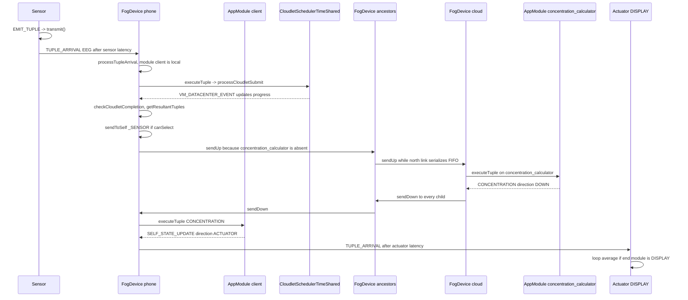

# Tuple lifecycle in the pinned iFogSim2 checkout

Inspection date: 6 November 2026.  
Simulator commit: `5f68d3947e450d8d2b4af42670be819206be68c9`.  
Scope: source inspection of the `Controller` plus `FogDevice` path used by `org.fog.test.perfeval.VRGameFog`. No simulator source was modified, and EAAS was not implemented.

Labels used below:

- **Verified:** behavior read from the cited method.
- **Interpretation:** a consequence of that code, not a separate experiment.
- **Recommendation:** a design choice for this project, not a simulator fact.

## 1. Executive summary

A tuple is a `Cloudlet`. A sensor creates it and delivers it to one gateway device. Each `FogDevice` then either executes it on a local `AppModule` or forwards it to its parent or to all of its children. Execution order on a module is CloudSim time-sharing: every accepted tuple runs at once, and the module's MIPS are divided by the number of tuples in the execution list. There is no priority, deadline, or per-tuple destination choice on this path.

Three mechanisms are separate:

| Mechanism | What it decides | When it runs on the VRGame path |
| --- | --- | --- |
| Module placement | Which device hosts which module | Once, in the `ModulePlacementEdgewards` constructor, before `CloudSim.startSimulation` |
| Tuple scheduling | How tuples already accepted by a module share that module's CPU | During the run, inside `TupleScheduler` / `CloudletSchedulerTimeShared` |
| Network routing | Which device receives the tuple next | During the run, in `FogDevice.processTupleArrival`, `sendUp`, and `sendDown` |

`FogBroker` does not route or schedule tuples. Its `startEntity` and `processEvent` are empty. `Controller` launches modules and prints aggregate results. It does not see each tuple.

The provisional integration strategy is a research-owned `FogDevice` subclass that decides admission and next device inside `processTupleArrival`, plus a research-owned cloudlet scheduler that can order CPU work. A placement policy alone cannot implement per-task EAAS. This strategy is not validated until a small experiment shows that a subclass can change destination and CPU order without editing `simulator/src`.

## 2. Complete tuple execution lifecycle

The path below is the one taken by an EEG sample in `VRGameFog` when `CLOUD` is false. Line numbers refer to the pinned tree.

### Stage 1. Sensor schedules emission

**Verified.** `Sensor.startEntity` (`simulator/src/org/fog/entities/Sensor.java`, lines 114–117) does two things:

- `send(gatewayDeviceId, CloudSim.getMinTimeBetweenEvents(), FogEvents.SENSOR_JOINED, geoLocation)`
- `send(getId(), getTransmitDistribution().getNextValue() + transmissionStartDelay, FogEvents.EMIT_TUPLE)`

`transmissionStartDelay` is initialized to `Config.TRANSMISSION_START_DELAY`, which is 50 (`simulator/src/org/fog/utils/Config.java`, line 25). `VRGameFog` uses `DeterministicDistribution(5)`, and `getNextValue` returns that constant (`simulator/src/org/fog/utils/distribution/DeterministicDistribution.java`, lines 12–14). The first `EMIT_TUPLE` is therefore scheduled at simulation time 55.

`FogDevice.processSensorJoining` only sends `FogEvents.TUPLE_ACK` back (`FogDevice.java`, lines 784–786). `Sensor.processEvent` ignores `TUPLE_ACK` (`Sensor.java`, lines 122–124).

### Stage 2. Sensor creates the tuple and submits it

**Verified.** `Sensor.processEvent` on `EMIT_TUPLE` calls `transmit()` and then schedules the next `EMIT_TUPLE` after `getTransmitDistribution().getNextValue()` (`Sensor.java`, lines 125–127).

`transmit` (lines 71–94):

1. Finds the `AppEdge` whose source equals `getTupleType()`. For the five-argument sensor constructor used by `VRGameFog`, `setSensorName(tupleType)` stores `"EEG"` (`Sensor.java`, lines 62–68).
2. Reads `tupleCpuLength` and `tupleNwLength` from that edge.
3. Constructs `Tuple` with direction `Tuple.UP`, CPU length from the edge, one PE, file size equal to the network length, and output size equal to the field `outputSize` (initialized to 3 and not set from the edge).
4. Sets `tupleType`, `destModuleName` from the edge destination (`client`), and `srcModuleName` from the sensor name (`EEG`).
5. Sets `destinationDeviceId` to the gateway id. Later forwarding does not read this field; it uses `destModuleName` and `direction`.
6. Calls `updateTimings`. If an `AppLoop` contains the edge sensor-name → destination, it allocates `TimeKeeper.getUniqueId()`, stores `CloudSim.clock()` in `emitTimes`, and stores that id on the tuple as `actualTupleId` (`Sensor.java`, lines 97–110).
7. `send(gatewayDeviceId, getLatency(), FogEvents.TUPLE_ARRIVAL, tuple)`.

In `VRGameFog` the sensor latency is 6. The tuple event is delivered 6 time units after `transmit`, not at the emit instant.

### Stage 3. The event reaches the gateway FogDevice

**Verified.** `FogDevice` extends `PowerDatacenter`. CloudSim delivers `SimEvent`s to `processEvent`. `FogDevice` does not override `processEvent`; it overrides `processOtherEvent` (`FogDevice.java`, lines 247–304). `TUPLE_ARRIVAL` calls `processTupleArrival`.

### Stage 4. FogDevice handles `TUPLE_ARRIVAL`

**Verified.** `processTupleArrival` (`FogDevice.java`, lines 674–756):

- If the device name is `"cloud"`, increments `cloudTrafficMap` for the current 1000-time bucket (lines 677–679).
- Sends `TUPLE_ACK` to the event source after `CloudSim.getMinTimeBetweenEvents()` (line 691). The sensor ignores that ack.
- If `tuple.getDirection() == Tuple.ACTUATOR`, calls `sendTupleToActuator` and returns (lines 696–698). CPU execution is skipped.
- If `appToModulesMap` for this app contains `tuple.getDestModuleName`, searches the host VM list for an `AppModule` of that name (lines 720–726).
- If no such VM exists, or `moduleCopyMap` already names a different VM id for that module, the method **returns without forwarding** (lines 727–731). **Verified drop:** the tuple is discarded and no counter is incremented.
- Otherwise it sets `tuple.vmId`, calls `updateTimingsOnReceipt`, then `executeTuple`.
- If the destination module is not in `appToModulesMap` for this device, `Tuple.UP` calls `sendUp` and `Tuple.DOWN` calls `sendDown` for **every** child (lines 738–754). There is no test that the child is on the path to the destination.

`updateTimingsOnReceipt` (lines 758–781) updates a loop average only when the loop edge matches and `loop.isEndModule(destModule)`. For the VRGame loop the end name is `DISPLAY`, which is an actuator, so this method does not close that loop.

### Stage 5. Network queue or immediate transmission

**Verified.** This stage applies only when the module is not local.

`sendUp` (lines 871–879): if `parentId > 0` and the north link is free, `sendUpFreeLink`; otherwise `northTupleQueue.add(tuple)`. The queue is a `LinkedList` created at lines 124–125. `poll` in `updateNorthTupleQueue` (lines 854–860) removes the head. That is FIFO, not priority.

`sendUpFreeLink` (lines 863–868):

- `networkDelay = tuple.getCloudletFileSize() / getUplinkBandwidth()`
- marks the north link busy
- schedules `UPDATE_NORTH_TUPLE_QUEUE` on itself after `networkDelay`
- sends `TUPLE_ARRIVAL` to `parentId` after `networkDelay + getUplinkLatency()`
- `NetworkUsageMonitor.sendingTuple(getUplinkLatency(), tuple.getCloudletFileSize())`

`sendDown` / `sendDownFreeLink` (lines 882–909) are the same pattern using `getDownlinkBandwidth()` and `childToLatencyMap.get(childId)`. One `isSouthLinkBusy` flag covers every child. A transmission toward one child blocks transmissions toward the others. They share one FIFO.

The host's `BwProvisionerOverbooking` is not read by these methods. The bandwidth in the delay formula is the `FogDevice` uplink/downlink field set by the example.

`sendToSelf` (lines 913–915) delivers a newly created output tuple to the same device after `CloudSim.getMinTimeBetweenEvents()`, with no bandwidth term.

### Stage 6. The destination module is identified

**Verified.** Identification is a string compare: `AppModule.getName().equals(tuple.getDestModuleName())` (`FogDevice.java`, lines 723–725). The name was copied from `AppEdge.getDestination()` when the tuple was created. The device does not consult CPU load, queue length, deadline, or neighbor tables when choosing the module.

`getChildIdWithRouteTo` (lines 551–558) can walk children toward a device id, but `processTupleArrival` does not call it. `getChildIdForTuple` (lines 561–566) is only meaningful for `Tuple.ACTUATOR`, and `sendTupleToActuator` does not call it. The call is inside a comment (lines 646–657).

### Stage 7. CPU execution is scheduled

**Verified.** `executeTuple` (`FogDevice.java`, lines 788–815):

- For `Tuple.UP`, records the source module id in `AppModule.downInstanceIdsMaps` and sets `numInstances` to the largest such list.
- `TimeKeeper.tupleStartedExecution(tuple)` stores `CloudSim.clock()` under `tuple.getCloudletId()` (`TimeKeeper.java`, lines 44–46).
- `updateAllocatedMips(moduleName)` then `processCloudletSubmit(ev, false)` then `updateAllocatedMips` again.

`processCloudletSubmit` is `PowerDatacenter.processCloudletSubmit` (`PowerDatacenter.java`, lines 260–263), which calls `Datacenter.processCloudletSubmit` (`Datacenter.java`, lines 637–712):

- `updateCloudletProcessing()`
- `cl.setResourceParameter(...)`, which sets the cloudlet resource arrival time to `CloudSim.clock()` (`Cloudlet.java`, lines 853–872)
- `scheduler.cloudletSubmit(cl, fileTransferTime)`

`TupleScheduler` extends `CloudletSchedulerTimeShared` and does not override `cloudletSubmit` (`TupleScheduler.java`, lines 7–37). `CloudletSchedulerTimeShared.cloudletSubmit` sets status `INEXEC` and appends the cloudlet to `cloudletExecList` (`CloudletSchedulerTimeShared.java`, lines 55–67). It does not use `cloudletWaitingList`.

`Cloudlet.updateStatus`, when the new status is `INEXEC`, sets `execStartTime` to `CloudSim.clock()` (`Cloudlet.java`, lines 1009–1012). On this path that is the submit instant, because the tuple is not parked in the waiting list.

`Datacenter.processCloudletSubmit` then sends `CloudActionTags.VM_DATACENTER_EVENT` after the estimated finish time (lines 687–689). `PowerDatacenter.updateCloudletProcessing` often replaces that with a periodic event every `getSchedulingInterval()` (`PowerDatacenter.java`, lines 81–86 and 136–139). `VRGameFog.createFogDevice` passes scheduling interval `10` (`VRGameFog.java`, the `new FogDevice(..., 10, upBw, downBw, ...)` call).

### Stage 8. Processing completes

**Verified.** `PowerDatacenter.updateCloudletProcessing` calls `updateCloudetProcessingWithoutSchedulingFutureEventsForce`. `FogDevice` overrides that method (`FogDevice.java`, lines 420–497). It calls `host.updateCloudletsProcessing(currentTime)`, which reaches `CloudletScheduler.updateCloudletsProcessing` (`CloudletScheduler.java`, lines 89–108).

Progress added to each executing cloudlet is:

```text
timeSpan * getTotalCurrentAllocatedMipsForCloudlet(...) * Consts.MILLION
```

`CloudletScheduler.updateCurrentCapacity` (`CloudletScheduler.java`, lines 515–534) sums the VM's current MIPS share and divides by `max(pesInUse, number of PEs)`. Each tuple is created with `pesNumber` 1, and `AppModule` is constructed with one PE (`Application.java`, lines 64–70). **Interpretation:** N tuples in the exec list each receive `vmMips / N` while they all have remaining length. That is time-sharing, not FCFS and not space-sharing.

When remaining length reaches zero, the cloudlet moves to the finished list. `FogDevice.checkCloudletCompletion` (lines 500–528) then:

- calls `TimeKeeper.tupleEndedExecution`
- calls `Application.getResultantTuples`
- `sendToSelf` for each output tuple
- `sendNow(cl.getUserId(), CloudActionTags.CLOUDLET_RETURN, cl)`

The user id is the broker. `FogBroker.processEvent` is empty (`FogBroker.java`, lines 20–23), so the return event has no effect on the application.

`tupleEndedExecution` (`TimeKeeper.java`, lines 48–59) computes `CloudSim.clock() - tupleIdToCpuStartTime.get(cloudletId)` and folds it into `tupleTypeToAverageCpuTime`. The `else` branch does not increment `tupleTypeToExecutedTupleCount`. After the first sample of a type, `currentCount` stays 1, so each later sample replaces the stored value with `(previous + new) / 2`. **Verified:** the printed "TUPLE CPU EXECUTION DELAY" is not the arithmetic mean of all executions of that type.

### Stage 9. Output tuples are created and routed

**Verified.** `Application.getResultantTuples` (`Application.java`, lines 195–256) iterates edges whose source is the module that just finished. For each edge it looks up `SelectivityModel` on the pair `(inputTupleType, edgeTupleType)`. If `canSelect()` is true it builds a new `Tuple`:

- CPU length and network length come from the edge.
- `actualTupleId` is copied from the input tuple.
- Non-actuator edges keep `edge.getDirection()`.
- Actuator edges set direction to `Tuple.ACTUATOR` and set `destModuleName` to the edge destination (`DISPLAY` in the game). The actuator id is not set; the assignment is commented out (line 227).

`FractionalSelectivity.canSelect` returns `Math.random() < selectivity` (`FractionalSelectivity.java`, lines 26–29). The EEG → `_SENSOR` selectivity in `VRGameFog` is 0.9. **Verified:** output creation is stochastic and unseeded. This is sufficient to make two launches emit different tuple sets. It matches the earlier observation that two successful `VRGameFog` runs printed different loop and energy numbers. It is not claimed to be the only source of variation.

`checkCloudletCompletion` then `sendToSelf`. The same device's `processTupleArrival` either executes the new tuple or forwards it. Periodic edges are a second source of tuples: `processModuleArrival` calls `initializePeriodicTuples` (lines 829 and 840–846), which schedules `SEND_PERIODIC_TUPLE` after `edge.getPeriodicity()`. `sendPeriodicTuple` (lines 373–391) uses `Application.createTuple` and `sendToSelf`.

### Stage 10. The actuator receives the final tuple

**Verified.** On `Tuple.ACTUATOR`, `sendTupleToActuator` (`FogDevice.java`, lines 658–669) scans actuators that joined this device. `processActuatorJoined` stored `(actuatorId, latency)` (lines 394–397). If `tuple.getDestModuleName()` equals that actuator's type, it sends `TUPLE_ARRIVAL` to the actuator after the stored latency and returns. Otherwise it calls `sendDown` for every child.

`Actuator.processTupleArrival` (`Actuator.java`, lines 56–82) updates `TimeKeeper` when a loop has the edge `srcModule → destModule` and `destModule` is the loop's end module. Delay is `CloudSim.clock() - emitTimes.get(actualTupleId)`. The emit time is removed. The running average is a true mean: `(currentAverage * currentCount + delay) / (currentCount + 1)`, and the count is incremented. That is the value `Controller.printTimeDetails` prints as the application loop delay (`Controller.java`, lines 153–164).

For the VRGame loop, the end module string is `DISPLAY`. The closing timestamp is the actuator event time, which includes the actuator latency configured in the example (1.0). The start timestamp is the sensor `transmit` clock, before the sensor-to-phone latency of 6. **Verified:** this number is one loop's end-to-end simulated delay, not CPU time and not a per-hop latency.

## 3. Sequence of the VRGame EEG loop

This diagram is only the path that the methods above implement when `client` is on the phone and `concentration_calculator` is on `cloud`. Placement messages from the earlier run showed that shift. Selectivity may suppress the `_SENSOR` tuple; the diagram shows the case where it is emitted.



## 4. Source-level call graph

Startup, before any tuple, for `VRGameFog`:

1. `VRGameFog.main` → `CloudSim.init` → `createApplication` → `createFogDevices` → `new Controller` → `Controller.connectWithLatencies` (`Controller.java`, lines 59–67).
2. `new ModulePlacementEdgewards` → `mapModules` → `placeModulesInPath` → `createModuleInstanceOnDevice` (`ModulePlacementEdgewards.java`, lines 54–79; `ModulePlacement.java`, lines 47–69).
3. `Controller.submitApplication` stores the placement object and subscribes actuators (`Controller.java`, lines 188–209). It does not yet send launch events.
4. `CloudSim.startSimulation` → `Controller.startEntity` (`Controller.java`, lines 71–85).
5. `Controller.processAppSubmit` → for each placed module, `FogEvents.APP_SUBMIT` and `FogEvents.LAUNCH_MODULE` (`Controller.java`, lines 222–238).
6. `FogDevice.processModuleArrival` → `appToModulesMap` update → `Datacenter.processVmCreate` → `initializePeriodicTuples` (`FogDevice.java`, lines 817–829).

Per tuple after that:

```text
Sensor.processEvent(EMIT_TUPLE)
  Sensor.transmit
    TimeKeeper.emitTimes
    FogDevice.processOtherEvent(TUPLE_ARRIVAL)
      FogDevice.processTupleArrival
        FogDevice.executeTuple                         // module is local
          TimeKeeper.tupleStartedExecution
          FogDevice.updateAllocatedMips
          PowerDatacenter.processCloudletSubmit
            Datacenter.processCloudletSubmit
              CloudletSchedulerTimeShared.cloudletSubmit
        FogDevice.sendUp / sendDown                    // module is not local
          FogDevice.sendUpFreeLink / sendDownFreeLink
            NetworkUsageMonitor.sendingTuple
PowerDatacenter.updateCloudletProcessing
  FogDevice.updateCloudetProcessingWithoutSchedulingFutureEventsForce
    CloudletScheduler.updateCloudletsProcessing
    FogDevice.checkCloudletCompletion
      TimeKeeper.tupleEndedExecution
      Application.getResultantTuples
        FractionalSelectivity.canSelect
      FogDevice.sendToSelf
FogDevice.sendTupleToActuator                         // direction ACTUATOR
  Actuator.processTupleArrival
    TimeKeeper.loopIdToCurrentAverage
```

Classes that do **not** participate in this path:

| Class | Why it is absent |
| --- | --- |
| `FogBroker` | Empty event handler. Receives `CLOUDLET_RETURN` and does nothing. |
| `StreamOperatorScheduler` | It is only a subclass of `VmSchedulerTimeSharedOverbookingEnergy` with no new methods (`StreamOperatorScheduler.java`, lines 11–15). The host VM scheduler does participate; this subclass adds no policy. |
| `Controller.processTupleFinished` | Empty (`Controller.java`, lines 181–182). `TUPLE_FINISHED` is sent only when a cloud tuple has a null destination module (`FogDevice.java`, lines 716–718), which the game tuples do not. |
| `sendToCluster` | Defined on `FogDevice` (lines 1148–1155) but called from `MicroserviceFogDevice`, not from `processTupleArrival`. |
| `MobilityController`, `ClusteringController` | They emit `MODULE_SEND` / `MODULE_RECEIVE`. `Controller` does not. `Config.ENABLE_DYNAMIC_CLUSTERING` is true, but nothing in the `Controller` startup sends `START_DYNAMIC_CLUSTERING`. |

## 5. Placement versus scheduling versus routing

### A. Module placement

**Verified.** `ModulePlacementEdgewards.mapModules` runs from the constructor (`ModulePlacementEdgewards.java`, lines 54–59), which `VRGameFog.main` calls before `CloudSim.startSimulation`.

For each leaf-to-root path it estimates CPU load as the sum of `tupleRate * tupleCpuLength` over incoming edges (`placeModulesInPath`, lines 188–205 and 220–228). Sensor rate is `1 / getMeanInterTransmitTime()` (lines 117–122). Periodic edges use `1 / periodicity` (lines 133–136). Selectivity contributes `getMeanRate()` (line 170). A module is placed on the current device only if `totalCpuLoad + currentCpuLoad <= host.getTotalMips()` (line 228). Otherwise `shiftModuleNorth` walks parents until one fits (lines 268–296). If the walk reaches parent id `-1`, it logs that the modules could not be placed (lines 290–293).

`createModuleInstanceOnDevice` then calls `canBeCreated`, which calls `VmAllocationPolicy.allocateHostForVm` (`ModulePlacement.java`, lines 31–33 and 54–68). `AppModuleAllocationPolicy.allocateHostForVm` calls `host.vmCreate` (`AppModuleAllocationPolicy.java`, lines 26–33). That reserves RAM through `RamProvisionerSimple`. Failure prints "cannot be created" and returns false. The placement object still keeps going; it does not abort the JVM itself.

`Controller.processAppSubmit` later sends those module objects as `LAUNCH_MODULE`. `processModuleArrival` calls `processVmCreate` again (`FogDevice.java`, line 824). **Verified:** placement both reserves the module with `vmCreate` before the run and submits a second create event at startup. Whether the second create finds the VM already present depends on `Datacenter.processVmCreate` (`Datacenter.java`, lines 397–427). This investigation did not execute a debugger trace of that second call.

Runtime change of placement on the `Controller` path was not found. `MODULE_SEND` and `MODULE_RECEIVE` are handled by `FogDevice` (lines 282–287), but the send sites are `MobilityController`, `ClusteringController`, and `MicroservicesMobilityClusteringController`. `VRGameFog` does not construct those controllers.

Information used by edgeward placement: device MIPS, estimated rates, edge CPU lengths, selectivity mean rate, sensor/actuator association, and an existing `ModuleMapping`. It does not read queue length, instantaneous utilization, deadlines, or link bandwidth.

### B. Tuple scheduling

**Verified.** The scheduler that orders tuples is the module's `CloudletScheduler`, which `Application.addAppModule` constructs as `new TupleScheduler(mips, 1)` (`Application.java`, lines 63–70). `TupleScheduler` does not implement a queue discipline. `CloudletSchedulerTimeShared.cloudletSubmit` puts every tuple into the execution list.

MIPS accounting has two layers:

1. `FogDevice.updateAllocatedMips` (`FogDevice.java`, lines 569–589) deallocates all VM PEs, then requests `getHost().getTotalMips()` for every VM that has `runningCloudlets() > 0` or whose name equals the incoming module. Other VMs are given 0.
2. `VmSchedulerTimeSharedOverSubscription.allocatePesForGuest` (`VmSchedulerTimeSharedOverSubscription.java`, lines 40–96) grants that request when free MIPS remain. If several VMs each request the full host, `redistributeMipsDueToOverSubscription` scales them so the sum fits the host (lines 103–162).

**Interpretation:** a module with no running tuples is given 0 MIPS until a tuple arrives. A single busy module is given the whole host. Two busy modules split the host in proportion to their requests, which are equal in this code, so they split it evenly. Tuples inside one module then split that module's share evenly. Nothing in this chain reads `Cloudlet.getClassType`, which the Cloudlet comment calls a priority (`Cloudlet.java`, lines 161–164). A repository search found no scheduler call to `getClassType()`.

There is no separate CPU waiting-time queue on this path. Delay caused by other tuples appears as a slower MIPS share, not as time spent in `cloudletWaitingList`. The north, south, and cluster queues are network queues.

`TupleScheduler.getEstimatedFinishTime` (lines 21–30) returns `time + remainingLength / allocatedMips`. `Datacenter.processCloudletSubmit` uses the finish estimate from `cloudletSubmit`, which uses `getCurrentCapacity`, not this override. The override matters where `CloudletScheduler.updateCloudletsProcessing` calls `getEstimatedFinishTime`.

### C. Network routing

**Verified.**

- Next device for `Tuple.UP` is `parentId` only (`sendUp`, lines 871–878). There is no sibling hop.
- Next devices for `Tuple.DOWN` are all children (`processTupleArrival`, lines 741–743 and 751–753).
- Parent/child links are recorded by `Controller.connectWithLatencies`: the parent's `childToLatencyMap` stores the child's `uplinkLatency`, and the child id is added to `childrenIds` (`Controller.java`, lines 59–67).
- Uplink latency is added after the bandwidth term in `sendUpFreeLink`. Downlink latency is the value stored for that child, which was copied from the child's uplink latency at connect time.
- Contention is a single busy flag plus a FIFO. It is not a per-flow share of `BwProvisioner`.
- Neighbor routing exists only as `sendToCluster`, and the ordinary `FogDevice` tuple path does not call it.

If the parent id is not greater than 0, `sendUp` drops the tuple (`FogDevice.java`, lines 871–878). The cloud's parent is `-1` in `VRGameFog`.

### D. Resource management

| Resource | Where it is stored | Changes during the run? | Readable when a tuple arrives? |
| --- | --- | --- | --- |
| CPU capacity | `Pe` MIPS on the single `PowerHost` | The capacity value is fixed. The allocation changes in `updateAllocatedMips`. | `getHost().getTotalMips()` and `getHost().getTotalAllocatedMipsForVm(vm)` are public. |
| RAM | `RamProvisionerSimple`, consumed at `vmCreate` | Not changed by tuple arrival. Module RAM is the `addAppModule` argument (10 in the game). | Host RAM and VM RAM are on the host and `AppModule`. |
| Tuple-path bandwidth | `FogDevice.uplinkBandwidth` and `downlinkBandwidth` | The fields are not updated by tuple code. | `getUplinkBandwidth` / `getDownlinkBandwidth`. |
| Host bandwidth | `BwProvisionerOverbooking` with 10000 in `VRGameFog.createFogDevice` | Not used by `sendUpFreeLink` or `sendDownFreeLink`. | Present on the host, but it is not the transmission model. |
| Network queue | `northTupleQueue`, `southTupleQueue` | Yes. | `getNorthTupleQueue().size()` and `getSouthTupleQueue().size()`. No enqueue timestamp is stored. |
| CPU queue length | `CloudletScheduler.getCloudletExecList()` | Yes. Waiting list stays empty on this path. | `runningCloudlets()` is what `updateAllocatedMips` uses. |
| Energy | `FogDevice.energyConsumption` | Yes, in `updateEnergyConsumption` (lines 595–621), called from `updateAllocatedMips` and from `manageResources`. | `getEnergyConsumption()`. |
| Cost | `FogDevice.totalCost` | Yes, in the same method: `ratePerMips * lastUtilization * totalMips * elapsed`. | `getTotalCost()`. The printed cloud cost is this field for the device named `cloud`. |

`manageResources` (lines 338–341) only updates energy and reschedules itself every `Config.RESOURCE_MGMT_INTERVAL` (100). It does not migrate modules or reschedule tuples. `Controller.manageResources` only reschedules `CONTROLLER_RESOURCE_MANAGE` (`Controller.java`, lines 177–178).

`FogLinearPowerModel.getPower` is `staticPower + constant * utilization * 100`, with `constant = (maxPower - staticPower) / 100` (`FogLinearPowerModel.java`, lines 39–54). `updateEnergyConsumption` multiplies that power by elapsed time and by the previous utilization sample. `lastUtilization` is `min(1, totalAllocatedMips / totalMips)` (line 620). **Verified:** printed energy is this device accumulator. `PowerDatacenter` also adds host energy into `setPower` inside the overridden update method (`FogDevice.java`, line 477). `Controller.printPowerDetails` prints `getEnergyConsumption`, not `getPower`.

## 6. CPU and network execution model

**CPU.** One host, one PE, overbooking VM scheduler, time-shared cloudlet scheduler. A tuple's simulated CPU time grows when other tuples share its module or when another busy module shares the host. Completion is noticed on `VM_DATACENTER_EVENT`, which `PowerDatacenter` re-arms at the scheduling interval (10 in the example) rather than necessarily at the exact finish instant computed by `TupleScheduler`.

**Network.** Transmission delay is `cloudletFileSize / deviceBandwidth + latency`, then the link is exclusively busy for `cloudletFileSize / deviceBandwidth`. Latency is not the busy interval; it is added only to the delivery event. `NetworkUsageMonitor` adds `latency * fileSize`, not `bandwidthDelay * fileSize` (`NetworkUsageMonitor.java`, lines 7–8). The printed "Total network usage" divides that accumulator by `Config.MAX_SIMULATION_TIME` (`Controller.java`, lines 114–115).

**Interpretation:** the model can show that a larger file or a smaller uplink bandwidth delays the next hop, and that a second tuple waits while the first occupies the single north or south flag. It cannot show two children transmitting on independent links, and it does not apply the host `BwProvisioner`.

## 7. Resource-management architecture

The only periodic resource hooks on the VRGame path are:

- `Controller.startEntity` sends `RESOURCE_MGMT` to every device immediately and `CONTROLLER_RESOURCE_MANAGE` to itself at time 100 (`Controller.java`, lines 79–84).
- `FogDevice.manageResources` updates the energy integral and repeats every 100.
- `updateAllocatedMips` changes CPU shares when a tuple is submitted or when one finishes.

No method on this path marks a device unavailable, rejects a tuple because RAM is exhausted at arrival, or moves a module because the queue is long. RAM exhaustion can happen only at `vmCreate` during placement or `LAUNCH_MODULE`.

## 8. Measurement and instrumentation

| Quantity | Already stored? | Where | Gap |
| --- | --- | --- | --- |
| Sensor emit time for a loop-start edge | Yes | `TimeKeeper.emitTimes`, key `actualTupleId`, written in `Sensor.updateTimings` | Removed when the loop is closed. Not written for tuples that are not a loop start. |
| Arrival at a fog device | No | Clock is available inside `processTupleArrival` and is not saved | Needs a per-tuple log. |
| Network queue entry and exit | No | `northTupleQueue.add` and `poll` have no timestamps | Needs instrumentation around `sendUp` and `sendDown`. |
| CPU submit / exec-start | Partially | `TimeKeeper.tupleIdToCpuStartTime` keyed by `cloudletId`. `Cloudlet.execStartTime` and `getSubmissionTime()` are set in the same submit call | This is time-share admission, not exclusive-CPU start. The map is not cleared. It is not keyed by `actualTupleId`. |
| CPU completion of one tuple | Partially | Duration is computed in `tupleEndedExecution` and then discarded into a per-type smoother | `tupleIdToExecutionTime` is never written. `endTimes` is allocated and never written (`TimeKeeper.java`, lines 32 and 69; the write loop in `Controller.printTimeDetails` is commented out, lines 154–163). |
| Per-type CPU "average" | Yes, but not a mean | `tupleTypeToAverageCpuTime` | Count is not incremented after the first sample. |
| Loop end-to-end delay | Yes, as a running mean | `loopIdToCurrentAverage`, closed in `Actuator.processTupleArrival` | One number per loop, not a sample list. Cannot compute p95 or p99 from it. |
| Actuator delivery time | Only inside that average | `Actuator.processTupleArrival` | No per-tuple record remains after the average update. |
| Deadline, priority, class | Not on `Tuple` | `Cloudlet.classType` exists and is not read by these schedulers | Must be added by the research model. |
| Device CPU share | Queryable, not logged per tuple | `updateAllocatedMips`, `runningCloudlets` | No time series is kept for the experiment. |
| Network use | One double | `NetworkUsageMonitor.networkUsage` | Not bytes, not per link, not per task. The formula multiplies latency by file size. |
| Energy, cloud cost | Device totals | `getEnergyConsumption`, `getTotalCost` | Totals over the whole run. |
| Deadline-miss, throughput, queue wait, scheduler overhead | No | — | All require new per-task records. |

**Verified distinction:** the printed application loop delay is the mean of loop completions. The printed tuple CPU delay is a per-type smoother of time from `tupleStartedExecution` to `tupleEndedExecution`. Neither is a latency distribution, and neither knows an emergency class.

`Controller` then calls `System.exit(0)` (`Controller.java`, line 106). A research runner that needs to write files after the run cannot rely on code after `CloudSim.startSimulation` in `main`. A subclass that overrides `processEvent` and does not call `System.exit` can avoid that. That subclass does not exist yet.

`FractionalSelectivity` uses `Math.random()` with no seed. Reproducible p95 numbers require a seeded selectivity model or a deterministic one. That is an instrumentation requirement, not a change made here.

## 9. EAAS extension-point comparison

EAAS, as specified in `PROJECT_STATUS.md`, must choose local execution, a neighbor, the cloud, a bounded queue, or rejection for each task, using priority, slack, estimated service time, queue wait, and communication delay. The comparison below uses only hooks that exist in this tree.

### 1. Custom tuple scheduler

- **Controls:** order and MIPS sharing among tuples already submitted to one `AppModule`. `CloudletScheduler` exposes `cloudletExecList`, `cloudletWaitingList`, `cloudletPause`, and `updateWaitingCloudlets` (`CloudletScheduler.java`, lines 71–76 and 142–149). A subclass can pause non-emergency tuples and run emergency tuples first.
- **Does not control:** which device receives the tuple. `processTupleArrival` chooses the device before `executeTuple`. It also does not see the north/south queues.
- **Classes:** replace `TupleScheduler` on the `AppModule`. `Application.addAppModule` hardcodes `new TupleScheduler` (`Application.java`, line 70). `addAppModule` is public and not final, so a research subclass of `Application` can override it, or the research workload can call the public `AppModule` constructor. Neither requires an edit under `simulator/src`.
- **Per-task dynamic behavior:** yes, for CPU order on one module. No, for offloading.
- **Risk:** time-sharing will violate priority unless the new scheduler actually uses the waiting or paused lists. Estimated finish times must stay consistent with `updateCloudletsProcessing`, or completion events drift. Complexity is moderate, and it is not sufficient by itself.

### 2. Custom FogDevice subclass

- **Controls:** the decision in `processTupleArrival`, which is `protected` (line 674). A subclass can execute locally, call `sendUp`, call `sendDown` for one chosen child, call `sendToCluster`, or keep its own priority queue. `executeTuple`, `sendUp`, `sendDown`, `sendToSelf`, and `sendTupleToActuator` are also `protected`.
- **Does not control:** CloudSim's event loop, the host VM scheduler's overbooking math, or placement that already happened. `getModuleByName` is `private` (line 357); a subclass must scan `getHost().getVmList()` itself.
- **Upstream edit:** not required if the research scenario constructs the subclass instead of `FogDevice`. `VRGameFog` must not be edited; a new scenario class should instantiate the subclass.
- **Per-task dynamic behavior:** yes. This is the first point where a tuple can be sent somewhere other than "the device that already hosts `destModuleName`", or be refused.
- **Risk:** copying the current `DOWN` broadcast would duplicate tasks. The subclass must select one child. Cluster membership is empty unless some controller fills it, so "neighbor" is not free; the scenario must define who the neighbor is. Complexity is high because the method also performs timing and module-copy checks that the subclass must preserve or deliberately replace.

### 3. Custom module-placement policy

- **Controls:** the initial `deviceToModuleMap` consumed by `Controller.processAppSubmit`. A new `ModulePlacement` subclass implements `mapModules`.
- **Does not control:** the device chosen for each later tuple. After launch, forwarding follows module name and parent/child links.
- **Upstream edit:** not required. `ModulePlacement` is abstract and public.
- **Per-task dynamic behavior:** no. Re-running placement during the run would require a new caller. The existing runtime movers are the mobility and clustering controllers, which move whole modules, not one tuple.
- **Risk:** using placement as if it were EAAS would answer a different question (where the service is deployed) and would not produce per-task deadline decisions. Complexity of a new placement class is moderate, and it is the wrong primary hook. It remains the right implementation for the static-fog baseline.

### 4. Controller-level orchestration

- **Controls:** application launch, the stop event, and any new events a subclass sends. `processTupleFinished` is empty, and normal tuples are not sent to the controller.
- **Does not control:** routing, unless devices are changed to ask the controller and wait for a reply.
- **Upstream edit:** not required for a `Controller` subclass, but the devices must cooperate. That cooperation is a `FogDevice` subclass or an upstream edit. Two new types, plus at least one extra event delay of `CloudSim.getMinTimeBetweenEvents()` per decision.
- **Per-task dynamic behavior:** only after the device path is changed to consult it.
- **Risk:** the controller does not currently hold queue lengths or per-link state. Shipping that state on every tuple adds simulation traffic that is easy to confuse with application traffic. `System.exit` in the base `processEvent` must not be inherited if results need to be written. Complexity is higher than a device-local decision without a clear gain for the first experiment.

### 5. Editing FogDevice's event switch

- **Controls:** the same decision as option 2, by editing `processOtherEvent` or `processTupleArrival` in upstream.
- **Does not control:** anything option 2 cannot control.
- **Upstream edit:** required. That violates the current repository rule unless a measured attempt shows a subclass cannot reach the needed state.
- **Per-task dynamic behavior:** yes.
- **Risk:** every example, including `VRGameFog`, would run the research policy. Merging later upstream fixes becomes harder. Complexity of the edit itself is lower than a subclass only because the code is already in place, and that is not a research advantage.

## 10. Recommended architectural integration strategy

**Recommendation, provisional:** implement EAAS as two research-owned types, and keep placement as a separate baseline.

1. A `FogDevice` subclass overrides `processTupleArrival`. On each application tuple it either submits the tuple to a local module, enqueues it in a research-owned priority queue, forwards it to one chosen parent or child, or drops it with a recorded reason. The subclass must not use the current "send to every child" behavior when a single destination is intended.
2. A cloudlet scheduler other than `CloudletSchedulerTimeShared` is installed on research-built `AppModule`s so that emergency tuples are not automatically given an equal MIPS share. Queue reordering is not preemption; preemption claims stay out until the scheduler pauses or removes a running cloudlet and that behavior is tested.
3. `ModulePlacementEdgewards` or `ModulePlacementMapping` is used only to decide where module replicas exist at startup. That is the static-fog baseline, not EAAS.
4. A `Controller` subclass overrides the stop path so the run can emit per-task logs without `System.exit` preventing the write. The subclass does not make the per-tuple decision.

This matches the research problem because the decision is per arriving tuple and can use queue length, local MIPS, and the known parent/child latency at that moment. Placement cannot. A tuple scheduler alone cannot offload.

**Not yet verified:** that a subclass compiled outside `simulator/src` can be constructed with the public `FogDevice` constructor, launched by the existing `Controller`, and change one tuple's destination. That is the next experiment, not a claim of this note.

Neighbor offload remains incomplete even with the subclass. `sendToCluster` works only for ids in `clusterMembers`, and `Controller` never fills that list. The first traffic scenario should treat "neighbor" as an explicit parent or child in the tree, or it must build cluster membership itself. Calling that a general fog neighborhood would over-claim the model.

## 11. Limitations and research risks

- **No per-task sample list.** p95, p99, deadline-miss ratio, and class-specific latency cannot be computed from `loopIdToCurrentAverage`.
- **Printed CPU delay is not a mean**, because `tupleEndedExecution` does not increment its count.
- **Unseeded `Math.random`** in `FractionalSelectivity` changes which tuples exist. Experiment selectivity should be deterministic or seeded before any comparison.
- **Downward forwarding fans out.** A careless scheduler port will multiply tasks.
- **Silent drops** when `moduleCopyMap` disagrees with the local VM (`FogDevice.java`, lines 727–731) and when `sendUp` has no parent.
- **One link flag per direction**, not a topology of independent links. Bandwidth contention results will describe this flag, not a full network.
- **Host `BwProvisioner` is not the tuple transmission model.**
- **No device-failure state** on the tuple path. A failure experiment has to define what "unavailable" means and enforce it in the subclass.
- **`System.exit(0)`** ends the JVM inside the stop event.
- **Two energy accumulators** exist. Papers must say which field was read.
- **`Cloudlet.classType` is not a scheduling priority** in this path.
- **Loop delay includes sensor latency, every hop, CPU sharing, selectivity survival, and actuator latency.** It is not emergency-task latency.
- **Numeric `VRGameFog` results vary across launches.** They remain environment checks only.

## 12. Suggested next implementation milestone

Do not implement EAAS next.

Build the smallest research-owned scenario that:

1. Constructs one cloud, two fog devices, two sensors, and one actuator without editing `VRGameFog.java`.
2. Uses a `FogDevice` subclass whose `processTupleArrival` logs simulation time, tuple id, device name, destination module, direction, exec-list size, and north/south queue size, then calls the superclass method.
3. Uses a `Controller` subclass that writes those logs and the loop result without relying on code after `System.exit`.
4. Runs two fixed tuple sizes and shows that CPU completion time and one-hop delivery time move in the expected direction.

Only if that subclass cannot observe or divert a tuple should an upstream patch be considered. The patch must be limited to the method that blocked the subclass, and it must be recorded in `PROJECT_STATUS.md` before it is written.
